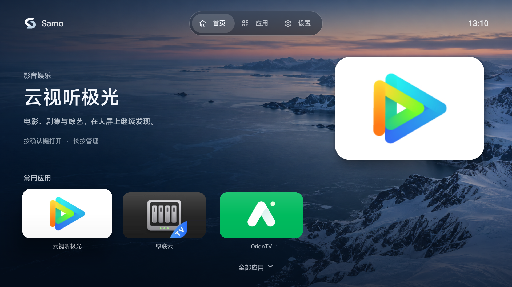
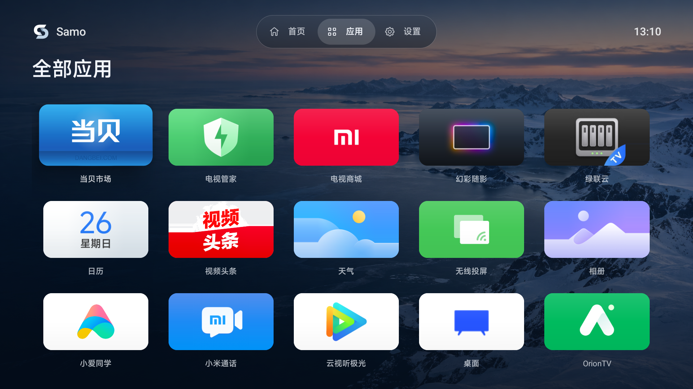
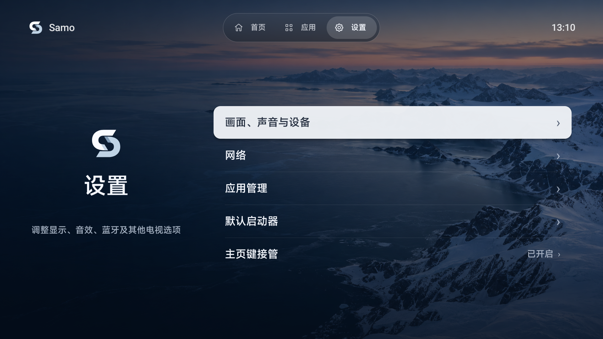

<div align="center">
  <h1>Samo TV</h1>
  <p>一个干净、离线的电视桌面</p>
  <p>
    <a href="https://github.com/Samoyer/samo-tv/releases/latest">下载 APK</a> ·
    <a href="#安装与设置">安装指南</a> ·
    <a href="docs/BUILD.md">源码构建</a> ·
    <a href="LICENSE">GPL 3.0</a>
  </p>
</div>



<p align="center">界面示例截取自 1.3.2；当前版本为 1.3.3。</p>

Samo TV 是面向电视遥控器的轻量 Android 启动器。把常用应用放在眼前，用方向键和确认键就能到达需要的地方。

- **常用应用，一眼找到**：首页展示常用应用，支持添加、移除并保留列表顺序。
- **为遥控器设计**：清晰的焦点反馈、五列应用网格，兼容电视与普通 Android 应用入口。
- **离线也完整**：内置海岸壁纸，无广告，无统计 SDK，无网络权限。
- **设置集中可达**：电视设置、网络、应用管理和默认启动器入口集中在一页。
- **可选主页适配**：对受支持的厂商桌面提供主页返回适配，由用户授权，随时可暂停。

## 界面一览

### 全部应用



五列网格展示已安装应用；长按确认键或按菜单键，即可管理常用应用或查看应用信息。

### 设置



常用系统入口集中呈现，主页适配状态可直接查看。

三张界面示例均来自 1.3.2。截图中的第三方应用及图标仅展示已安装应用的效果，不随 Samo TV 捆绑提供。

## 下载

当前版本：**1.3.3**（versionCode `7`），包名 `cn.samo.tv`。支持 **Android 6.0 / API 23 及以上**。

- [下载 Samo TV 1.3.3 APK](https://github.com/Samoyer/samo-tv/releases/download/v1.3.3/samo-tv-1.3.3.apk)
- [下载 SHA-256 校验文件](https://github.com/Samoyer/samo-tv/releases/download/v1.3.3/samo-tv-1.3.3.apk.sha256)
- [查看发布记录与其他版本](https://github.com/Samoyer/samo-tv/releases)

将 APK 与校验文件放在同一目录，可运行：

```sh
shasum -a 256 -c samo-tv-1.3.3.apk.sha256
```

## 安装与设置

### 安装 APK

下载后，可通过电视的 APK 安装入口安装，或在电脑上使用 [Android SDK Platform-Tools](https://developer.android.com/tools/releases/platform-tools) 中的 ADB。

开启电视的 ADB 调试并授权当前电脑，确认设备状态为 `device` 后执行：

```sh
adb devices
adb install -r samo-tv-1.3.3.apk
adb shell am start -n cn.samo.tv/.MainActivity
```

同时连接多台设备时，请在 `adb` 后添加 `-s <设备序列号>`。

### 设置主页

1. 打开 Samo 的「设置 → 默认启动器」，按系统提示选择 Samo TV。
2. 对于受支持的厂商桌面，也可进入「设置 → 主页键接管 → 系统无障碍设置」，手动启用 Samo TV 服务，并开启应用内接管开关。
3. 使用遥控器检查主页键返回、应用启动和系统设置入口。

部分系统不允许选择第三方默认桌面。可选主页适配仅匹配特定厂商桌面的窗口，不是通用的主页键拦截方案；安装门槛不代表所有设备的主页与开机行为均兼容。

### 恢复原桌面

在「设置 → 主页键接管」中暂停接管，或在系统无障碍设置中关闭 Samo TV 服务。如果已更改默认桌面，再到系统默认启动器设置中选择原桌面。

## 遥控器操作

| 操作 | 行为 |
| --- | --- |
| 方向键 | 在首页、应用网格和设置间移动焦点 |
| 确认键 | 打开选中应用或设置项 |
| 长按确认键 / 菜单键 | 添加或移出常用、查看应用信息 |
| 返回键 | 关闭弹层或返回首页 |
| 主页键 | 按系统默认桌面或已授权的主页适配返回 |

首页「全部应用」进入应用网格，网格首行向上可返回顶部导航。常用应用允许保存为空，升级会保留已保存的列表及顺序。

## 隐私与权限

- 应用不申请网络或悬浮窗权限，不上传应用列表与使用记录。
- `RECEIVE_BOOT_COMPLETED` 用于接收开机通知；实际启动仍受系统限制。
- 可选无障碍服务仅监听指定桌面的窗口状态事件，不读取窗口内容、不过滤按键、不执行手势。服务需手动授权，可随时关闭。

## 开发

使用 Java 与 Android 系统组件实现，不依赖第三方运行时库，不使用 Gradle。

完整的环境准备、SDK 安装、APK 构建、签名与测试说明见 [构建指南](docs/BUILD.md)。

## 致谢与许可

界面布局参考 [SunnyTV](https://github.com/xudong7587/SunnyTV) 与 Apple TV / tvOS 的视觉方向，采用独立原生实现，未引入参考项目的代码或演示素材。内置海岸壁纸由 AI 生成，随应用离线提供。

Copyright (C) 2026 Samoyer

本项目采用 [GNU General Public License v3.0](LICENSE)（SPDX: `GPL-3.0-only`）。
